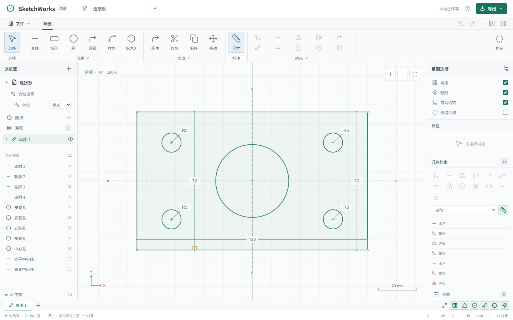
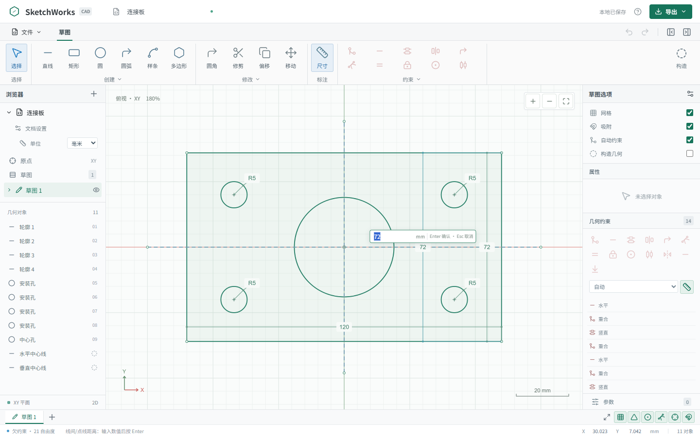
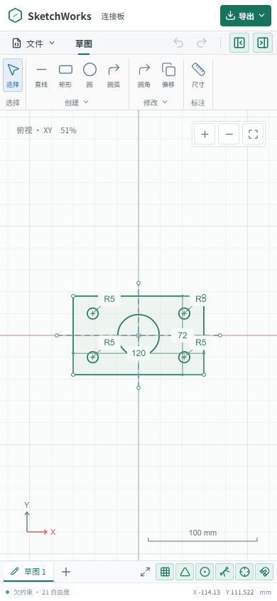

# SketchWorks

Fusion 草图风格的网页版二维参数化 CAD。默认进入可编辑的连接板草图，不需要账户或远程服务。当前版本为可运行的二维草图原型，不是 Autodesk Fusion 的完整替代品。

## 界面


标注时先选几何，悬停第二个对象即可预览距离或夹角，点击空白处固定标注线后就地输入数值。

| 悬停预览距离                                            | 固定标注后输入数值                                     | 切点捕获                                          |
| ------------------------------------------------------- | ------------------------------------------------------ | ------------------------------------------------- |
|  |  |  |

移动端使用同一套画布与工具栏：



以上截图可用 `pnpm docs:shots` 在本地开发服务运行时重新生成。

## 运行

需要 Node.js 20.19+ 或 22.12+，以及 pnpm。依赖由锁文件固定，WASM 随应用本地提供。

```sh
pnpm install
pnpm dev -- --port 5173
```

打开 http://127.0.0.1:5173 。

```sh
pnpm test              # Vitest 单元回归（求解、创建、尺寸、捕获、导出）
pnpm build             # 类型检查与生产构建
pnpm preview -- --port 5174
pnpm test:browser      # 端到端流程与截图
pnpm test:grid         # 网格绘制与网格捕获
pnpm test:canvas       # Canvas 渲染、命中与大批量场景
pnpm test:dimension    # 尺寸选取、悬停预览、定位输入与标注拖动
pnpm test:endpoints    # 端点捕获、约束与拖动
pnpm test:snap-options # 五类捕获开关
pnpm test:commands     # 镜像、阵列与约束的命令参数面板
pnpm test:circles      # 默认直径、完整标注跨度与圆形属性输入
pnpm test:contours     # 连续轮廓双击选择、分支与 Ctrl 扩展
pnpm test:pdf          # PDF 下载、范围、尺寸及中文显示
pnpm test:files        # 虚拟文件管理器：目录、保存、导入导出与附件
pnpm test:recovery     # 切换项目前的保存、写入失败与整包资源恢复
pnpm docs:shots        # 重新生成 README 截图（需 dev 服务运行）
pnpm format
```

浏览器测试使用 Playwright Chromium。未安装 Chromium 时，Windows 上可以自动使用已安装的 Google Chrome；也可用 `CAD_BROWSER_PATH` 指定浏览器，`CAD_URL` 指定待测应用 URL。截图写入 `artifacts/`（已被 git 忽略）。

## 已实现

- 创建：连续直线、中点线、两种矩形、两种圆、两种圆弧、内接/外接多边形、椭圆、直槽、圆弧槽、插值样条、三次贝塞尔、有理二次圆锥曲线、点、文本。
- 编辑：选择、多选、框选、控制点拖动、缩放和平移视图、网格和端点吸附、构造几何、撤销/重做。双击连续相连的线或曲线选择整个无分支轮廓，包含矩形与多边形；遇到分支停止，Ctrl（macOS 可用 Cmd）双击跨分支扩展并追加选择。
- 约束：重合、水平、竖直、平行、垂直、相等、固定、点在线上、相切、同心、中点、对称、共线。点击约束按钮后先打开命令面板，按面板提示逐个拾取几何再确认。
- 尺寸：长度、平行线距离、水平/竖直距离、半径、直径、角度。点击“尺寸”后像画线一样直接在图上点选几何或两个端点，类型按选择自动推断（单线长度、平行线距离、相交线夹角、圆弧直径、两点距离），数值就地输入并回车确认，不再弹出对话框；双击已有标注标签同样就地编辑。
- 修改：直线角部圆角/倒角、切向关联过渡曲线、偏移、受支持类型的修剪/延伸/断开、移动、复制、旋转、缩放。所有修改命令都先在命令面板中确认对象和数值再提交。
- 关联：镜像随镜像轴更新，矩形/环形阵列随源几何更新；间距/角度可引用参数，单个副本的变换可编辑，关联可显式解除。
- 文档：多草图、可见性、毫米/英寸显示、本地自动保存、JSON 工程保存/打开。
- 输出：DXF 原生 LINE/CIRCLE/ARC/ELLIPSE/SPLINE/TEXT/POINT；SVG；PDF 图纸。可选择当前草图或所有可见草图，并选择是否包含构造几何。PDF 使用 A4 纸张自动横竖排版，保留尺寸标注、几何矢量线条和中文文本。

## Canvas 绘图区

绘图区使用一个高 DPI Canvas 2D，不再为每条几何或控制点创建 SVG DOM。静态底图通过离屏 Canvas 缓存；预览、吸附和框选按 requestAnimationFrame 合成。Path2D 按对象 ID 和几何指纹缓存，RBush 空间索引用于视口裁剪、几何命中和吸附查询。平移缩放、尺寸标注与控制点命中都使用同一毫米/Y-up 坐标变换。

右下角提供网格、中点、端点、切点、相交点五个独立捕获开关，磁铁按钮和草图选项中的“吸附”仍为总开关；草图选项中的“网格”只控制网格线显示，隐藏网格不改变网格捕获设置。中点捕获支持直线、圆弧、样条、贝塞尔和圆锥曲线的路径中点。切点捕获支持圆与圆弧：绘制直线或中点线的第二个点时按起点计算，拖动直线端点时按另一端点计算。相交点捕获使用活动草图中可见路径的实际交点。开启自动约束时，中点、切点、相交点及原点捕获会建立对应的几何关系，不会虚构端点或控制点引用；关闭自动约束时只捕获坐标。

路径端点会优先自动捕获，范围为 10 CSS 像素，使用绿色圆形和“端点”状态提示；直线、圆弧、样条、贝塞尔及圆锥曲线支持真实端点，圆心及内部控制点不冒充端点。关闭总吸附开关则停止所有捕获，各分类开关设置保留。绘制时开启自动约束会为基础几何端点建立重合关系；镜像、阵列等关联副本端点只捕获坐标，不直接添加不支持的约束引用。

拖动输入最多每帧求解一次，同一捕获目标不会重复求解。组合整体拖动会在开始时冻结成员范围，从上一次有效几何增量平移，而不反复重置到原位置；矩形、槽等连接成员使用一致的平移初值，并在提交前校验成员相对位置和几何参数。控制点拖动仍保持独立编辑语义，固定及关联对象的限制不被解除。原始快照只用于取消和一次撤销。整体移动使用对象首控制点作为基准，保留鼠标抓取偏移；移动中的约束关联对象不作为静止捕获目标。一般捕获进入范围为 8 CSS 像素，路径端点为 10 CSS 像素，静态捕获释放范围为 12 CSS 像素，减少边界抖动；切点和相交点按当前几何实时重算。松开时重新计算当前指针位置，并在现有约束允许的情况下精确提交捕获点；若目标不可达则保留有效位置并提示，不破坏原约束或新增永久网格约束。一次拖动仍对应一次撤销。

Canvas 优化的是绘制和命中检测，复杂约束的数值求解耗时仍取决于 PlaneGCS。SVG/DXF 文件输出不依赖屏幕渲染实现。

## 尺寸标注

点击“尺寸”（或按 D、用属性面板的“添加尺寸”）进入标注状态。类型按所选几何自动推断：

| 选择         | 生成的尺寸                            |
| ------------ | ------------------------------------- |
| 单条直线     | 该直线的长度                          |
| 两条平行直线 | 两线之间的垂直距离                    |
| 两条相交直线 | 两线夹角                              |
| 直线与点     | 点到直线的垂直距离，两种选择顺序均可  |
| 圆或圆弧     | 直径                                  |
| 两个点       | 对齐时用水平/垂直距离，否则用点间长度 |

在图上选中第一条直线后，会出现长度标注预览；移到第二条直线上可预览两线的距离或夹角，点击第二条线确认对象。线与点、点与线之间自动测量垂直距离，两个点之间按对齐情况测量水平/竖直距离或实际长度；选中第一个点后，悬停第二个点或直线也可预览。长度、距离和角度都需点击空白处固定标注位置，之后才出现就地数值输入框，输入数值或参数表达式后，左键点击绘图区空白处或按 Enter 提交；右键点击绘图区或输入框、按 Esc 都可取消，未通过校验的数值会保留供修正。圆默认使用 Ø 直径尺寸，标注线穿过圆心连接圆周两端，线长与直径一致；属性面板及圆形大小输入也默认显示直径。手动选择半径尺寸时保留 R 半径标注。标注位置随工程保存；已选中几何再进入尺寸工具同样需要定位。标注状态下可连续标注，按 Esc 或切换工具退出；尺寸工具激活时，可直接拖动已有标注调整位置，松开左键保存；拖动时右键或 Esc 取消调整，单击不会进入位置调整状态；双击标注数值进入数值编辑，确认或取消方式与新建尺寸相同。属性面板的“尺寸类型”可固定为长度、线间/点线距离、水平/竖直距离、半径、直径或角度。

平行线距离是真实约束：它固定一条线上的一点到另一条直线的垂直距离（PlaneGCS `p2l_distance`）。只约束距离时求解器可能旋转直线，因此若这两条线在标注时是平行的，创建尺寸会同时补上一条平行约束让它们保持平行；若两线本身已有方向约束（水平/竖直/平行/垂直/共线/角度），则不再重复添加，避免冗余冲突。该尺寸的参考形式为“第一条线的一个端点 + 第二条线”，拖动机何时按点到直线的垂直距离求解。

## 命令参数面板

镜像、矩形/环形阵列、移动、复制、偏移、旋转、缩放、圆角、倒角、过渡曲线、修剪、延伸、断开、解除关联以及全部几何约束都使用同一套命令面板，不再“点一下就执行”：

- 打开命令时，已有选中对象自动填入“对象”参数（镜像线、阵列方向等参考几何不会被抢占），面板随即激活第一个尚未填写的参数。
- 每个几何参数一行：点击该行（或“选择”按钮）激活它，然后在绘图区点选几何、框选多个对象，或直接点选位置参数（中心、基点、修剪位置）；激活行会被高亮。
- 行右侧的 ✕ 清空该参数并保持激活，可立即重新选择；已选列表中的每一项也可单独移除。点击已选对象会取消选择，方便反复修正。不同参数不能引用同一个对象或点，矩形阵列的方向可以使用对象数组中的直线。
- 约束面板按约束类型给出对应输入（平行=两条直线，相切=直线/圆/圆弧，对称=两点加对称线或中心点等），当前选择不适用时“确定”保持禁用并给出提示。
- 数值参数与几何参数同面板显示，仍支持参数表达式；阵列提供“分发（间距/范围）”“数量 1/2”“距离 1/2”和“方向 1/2（单向/反向/对称）”。
- “确定”提交一次可撤销的操作；“取消”、Esc 或切换工具退出并恢复打开面板前的选择。Delete/Backspace 只清空当前参数，不会删除草图对象；Ctrl+A 选中全部对象填入当前参数。

矩形阵列的方向参数可选一条直线：第一方向沿该直线，第二方向与其垂直，因此可以生成斜向阵列；不选方向时使用 X/Y 轴。数量包含原对象，“对称”方向要求奇数数量；“范围”表示最外侧实例之间的总距离。切换草图、打开或新建文档时清空命令及旧选择；切换单位时退出当前命令，避免旧单位输入被按新单位解释。

## 数据与求解

内部几何统一使用毫米和 Y 向上坐标系。英寸仅改变显示与数值输入，DXF 的 `$INSUNITS` 始终为 4（毫米），SVG 使用毫米物理尺寸，避免单位切换造成比例错误。

PlaneGCS WASM 是真实数值约束求解器。编辑先在文档副本上应用参数、求解源几何、更新派生对象并校验；失败的操作不会覆盖已提交的有效草图。固定约束持久保存锚点；一次拖动对应一次历史操作。关联对象不重复添加源对象约束，需编辑源或解除关联后再约束。

参数使用受限 mathjs 语法树，只允许数值、参数、括号和四则运算。长度、角度和无量纲参数分开处理；拒绝循环引用、除零、函数调用、赋值及属性访问。参数编辑格式为每行 `名称, 表达式, mm|deg|scalar`。

## 项目文件与虚拟文件管理器

浏览器内使用 IndexedDB 虚拟文件系统管理工程：支持文件夹、面包屑、搜索、排序，以及重命名、移动、复制和带确认的删除；同级名称按 NFC 且不区分大小写保持唯一，根目录不可删除。标题栏的“文件管理器”按钮或 Ctrl+O 打开浏览模式，Ctrl+Shift+S 打开另存为模式。

工程另存为 `.swcad` 后缀的单文件。文件名后缀与内容格式相互独立：`.swcad` 内部是标准 ASAR 归档，因此 `asar list`/`asar extract` 等官方工具可以直接读取。归档包含：

- `manifest.json`：`format: "sketchworks-project"`、版本、模块表和每个文档的编解码声明。
- `documents/sketch.jsonb.gz`：二维草图以二进制 JSON（MessagePack）编码后再经 gzip 压缩，因此“JSONB”指二进制 JSON 容器，而不是 PostgreSQL JSONB 类型，也不是纯文本 JSON。
- `assets/<id>.<后缀>`：图片附件按原始字节单独存放，不参与压缩，读取后字节完全一致。

Ctrl+S 保存已关联的工程，未关联时打开保存管理器；Ctrl+Shift+S 另存为；“下载项目”导出真正的 `.swcad` 文件，“导出 JSON 草图”保留旧版纯文本 JSON 输出。导入除 `.swcad` 外仍兼容旧版 `.asar` 与 `.json`。切换工程、新建或导入前会先落盘当前编辑，保存失败则保留当前文档和撤销历史并给出提示。

归档中的未知模块、未知清单字段和未被识别的文件在编辑、重新编码和另存时原样保留，为后续三维建模、CAM 加工和更多附件类型预留扩展位置而不必升级本次格式。防护上限为归档与单个文件 100 MiB、解码后草图 10 MiB、清单 5 MiB、条目 10000 个。

## 当前边界

- 通用曲线的控制点可以固定或重合，但未实现完整的样条/贝塞尔相切或曲率连续约束。过渡曲线通过关联源端点和端部切线保持切向连续。
- 圆角和倒角目前支持两条相交直线。修剪、延伸和断开仅开放已有精确实现的类型，不支持的组合会给出明确错误。
- 椭圆、样条、贝塞尔和圆锥曲线偏移为约 0.001 mm 采样精度的折线近似，名称标记为“偏移（近似）”。圆与圆弧单体偏移保留原生解析几何。
- 阵列数量为创建时确定的拓扑；调整数量需要重建阵列。尚无 Fusion 的草图时间线、云协作、三维建模和制造模块。
- DXF/SVG 输出几何而不是求解约束或参数关系。保留可编辑工程关系应使用 `.swcad`，也可导出 JSON 草图用于交换。文本保留为文本对象，不自动转换成字形轮廓。
- 本地自动保存现已写入浏览器的 IndexedDB 虚拟文件系统；localStorage 仅保留旧版 JSON 快照作为兼容备份。重要工程仍建议另存为 `.swcad` 文件。
- 虚拟文件系统只在当前浏览器内生效，不提供云同步、多设备合并或文件冲突解决；附件目前只接受 PNG/JPEG/WebP/GIF。

## 结构

`src/model.ts` 定义稳定 ID 和导入校验；`solver.ts` 接入 PlaneGCS；`creation.ts` 与 `operations.ts` 提供几何工具；`parameters.ts` 解析参数；`Viewport.tsx` 提供画布交互；`export.ts` 负责输出；`App.tsx` 统一提交、历史、文档和界面。

`virtualFileSystem.ts` 管理 IndexedDB 元数据、Blob 内容和隐藏工作区；`projectArchive.ts` 实现标准 ASAR、MessagePack 与 gzip 编解码；`FileManager.tsx` 提供文件和图片附件管理；`useProjectWorkspace.ts` 管理当前文件关联、自动保存与完整项目恢复。

`src/*.test.ts` 包含真实 WASM、创建工具、拓扑修改、参数、关联关系、导出、虚拟文件系统事务与官方 ASAR 工具互操作回归。`tests/browser.mjs` 验证 CAD 端到端操作；`tests/file-manager.browser.mjs` 验证文件管理与附件；`tests/workspace-recovery.browser.mjs` 验证快速切换、保存失败与整包恢复。浏览器测试用真实 Chromium/Chrome，结果与截图写入 `artifacts`。

## 许可证

本项目以 MIT 许可证开源，全文见 `LICENSE`。第三方依赖保留各自许可证：运行时版本、完整许可文本，以及 LGPL PlaneGCS 的对应源代码获取与重建/替换说明，见 `public/THIRD_PARTY_NOTICES.txt`，该文件也包含在生产输出中。
